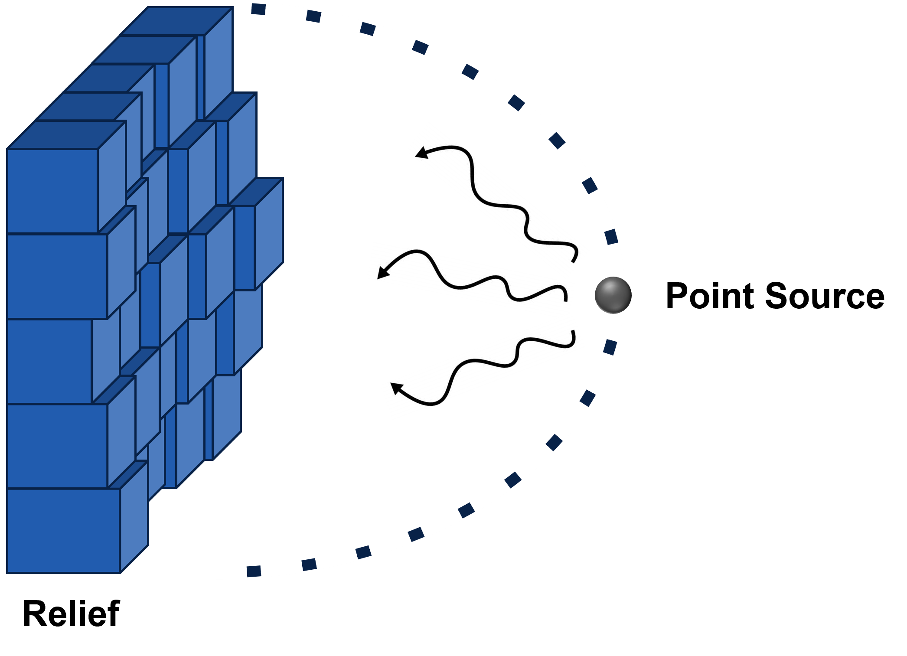
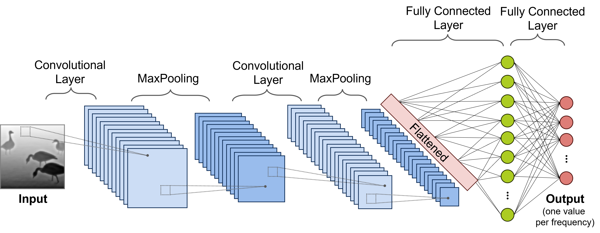
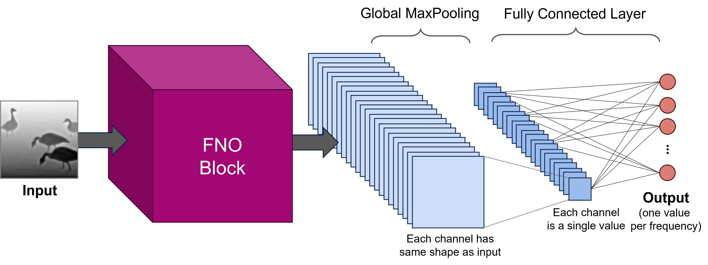
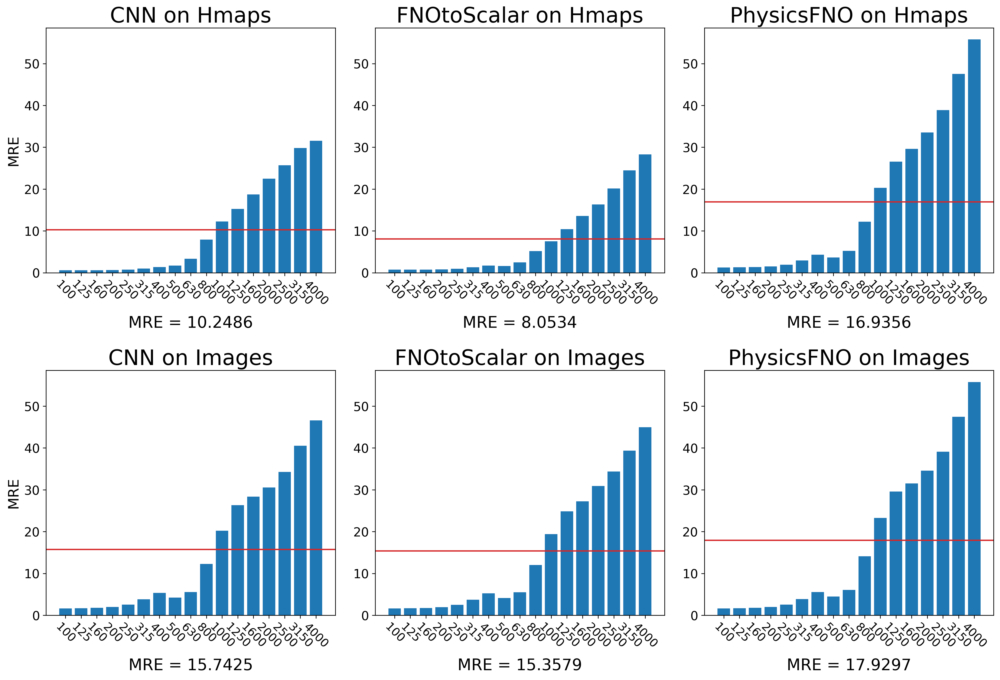

# Neural Operators for Acoustic Diffusers
_A concise description of your project (e.g., "A neural network augmented with PDE constraints for acoustic pressure modeling")._

## 📖 Abstract

This project explores **[problem statement]** by leveraging **[methods, models, or frameworks]**.  
We address **[research question / practical challenge]** and demonstrate **[key contributions / results]**.  
The repository doubles as both a **report of the work** and a **reproducible codebase**.

## Problem Statement
In this project, we aim to predict the acoustic diffusion coefficients produced by a given relief.  In particular, we consider a relief represented by a heightmap. This relief can for example be an acoustic diffuser as found in a sound booth. We then consider a point source to produce a sound signal. The signal travels to the relief where it is scattered. To evaluate the diffusion properties of the relief, we want to determine its acoustic diffusion coefficients for individual frequencies. To measure these coefficients one can compute the external acoustic pressures at listeners evenly placed on a hemisphere centered on the diffuser and then apply the diffusion coefficient formula per frequency to obtain the respective diffusion coeffecients.

<!--  -->

    

The computation of the pressures can be done using traditional physics solvers such as in [1], but it's very time-consuming, especially since it needs to be run for each relief individually. We therefore attempt employing machine learning methods to predict the diffusion coefficients.

<!-- 
Provide background and motivation:  
- Why this problem matters  
- Prior work or context  
- Scope and limitations -->

## Dataset 
As the base dataset, we used the Mini-ImageNet dataset, consisting of 100 classes of 600 images each. Of these, 32'825 were processed as follows:
- Using the Depth-Anything-V2 model, the depth of each point is estimated.
- Following Weyrich et al. [4], a Bas-Relief heightmap is generated from this depth information.
- The heightmap is cropped to a centered square and resized to size 256
- The heightmap is optimized w.r.t. a smoothness loss, to avoid abrupt height changes.
- The heightmap is padded with zeros at the borders.
These heightmaps were then stored as PNGs, see `generate_hmaps.py` to generate and save the heightmaps and `hmaps_png/` for the generated heightmaps.

To obtain the acoustic diffusion coefficients for a heightmap, a physical PDE solver is used, namely [1]. The entire pipeline from imapge to diffusion coefficients can be run with `run_pipeline.py`. The diffusion coefficients of the 32'825 processed images can be found in `mini_imagenet/coeffs.csv`.

<!-- ## 🏗️ Methodology

Explain the approach:  
- Theoretical background or governing equations  
- Frameworks, libraries, and datasets used  
- Simulation or experimental setup   -->

## Architectures Implemented

### CNN
As a baseline, we use a standard CNN architecture. We use two convolutional layers, both followed by a Max Pooling layer. The outputs are then flattened to be 1-dimensional and fed through two linear layers. The number of outputs corresponds to the number of frequencies for which we have have coefficients.

    

### FNO

#### Brief Introduction to FNOs
Where neural networks learn individual functions, predicting its output values given an input, neural _operators_ learn entire families of functions: they learn an operator between function spaces. Thus, given an input function, e.g. the initial conditions of a PDE, we can simply perform a forward pass through the trained neural operator and receive the corresponding solution function, rather than having to train an individual network for each set of input parameters. This makes neural operators especially relevant for solving PDEs, where traditional solvers are often very time consuming and have to be rerun for each individual set of initial conditions and parameters.

Fourier Neural Operators (FNOs) boost the efficiency of the original neural operators, by formulating the integral kernel directly in Fourier space and making use of properties of the Fourier transform. After an initial pointwise projection into a higher dimensional space, the input function is fed through an adjustable number of Fourier layers, and then (again pointwise) projected down to the desired number of channels. In each Fourier layer, the input is transformed into Fourier space, where convolution is now just multiplication. So the input is multiplied with a kernel matrix $R$ and then transformed back to physical space. Finally, a linear transformation of the input is added and a non-linear activation is applied. For more details, see [2]. 

    

When solving PDEs, FNOs can be further augmented by imposing a physics-informed loss based on the PDE, which improves both generalization and physical validity. For more details, see [3].

In our setting, our heightmap input can be interpreted as functions
$ 𝐻\colon [0, 256]^2\to ℝ\times[0,256]^2  $  from the space of pixel coordinates to the space of pixel coordinates times the channel values, which for weight maps are 1-dimensional.   
Our output coefficients can be interpreted as functions $𝐶\colon ℝ\toℝ$, taking in a frequency and outputting the corresponding  coefficient value.
 
However, for an FNO, Input and Output functions must be defined on the same domain, though they can have different codomains. In other words: the spatial dimensions are preserved, but the number of channels can change. Notably, **This is not satisfied by our setting!**

We considered two architectures to address this issue:

#### FNO with Global Pooling

    

In this architecture, we first run our inputs through a standard FNO block. This block predicts a 2D field for each channel, where the number of channels is a configurable hyperparameter. We then use global max pooling to reduce these 2D fields to a single value per channel, thus obtaining a 1D output. Finally, we append a linear layer to get the desired number of output channels, in our case the number of frequencies. An implementation of this class can be seen in `fno.py` in the class `FNOtoScalar`.

Unfortunately this architecture doesn't make use of a physical loss. While the complex acoustic pressures $u$ satisfy the Helmholtz equation
$$ \nabla^2 u + k^2\cdot u = 0 \,,$$
the diffusion coefficients are not as easily goverend by a PDE, especially since the function used to obtain the coefficients from the pressures is not invertible.

#### FNO with Latent Pressures
The lack of physical information in the previous architecture inspired the idea of interpreting the 2D output (per channel) of the FNO as a pressure field. We can then impose a physics loss, namely the Helmholtz equation above, on this pressure field. This must be done individually for each channel resp. frequency, since the wavenumber $k$ depends on the frequency.

    

After computing the physics loss, we can then obtain the coefficients from the pressures using the known diffusion coefficient function. Given the coefficients, we can then compare them to the ground truth coefficients and take a residual loss.

To compute the physics loss, we again make use of the Fourier transform, since this significantly simplifies differentiation: For a function $u(x,y)$ with a Fourier transform $\widehat{u}(k, j) = \mathcal{F}(u) (k, j)$, its second derivates satisfy
$$ \mathcal{F}(\partial_{xx} u) = -k^2 \, \widehat{u}(k, j) $$
$$ \mathcal{F}(\partial_{yy} u) = -j^2 \, \widehat{u}(k, j) $$
For an implementation of this loss, see the class `PDEloss` in `utils.py`

In the physics solver that produced our dataset, the acoustic pressures are considered to be complex-valued. We therefore also implemented a version of this loss that considers complex pressures. Instead of predicting complex values, we instead encode the complex values in two separate separate real-valued channels, one for the real part, one for the imaginary part. The FNO block must therefore have twice as many output channels as frequencies.

## Results

We trained and evaluated all model architectures described above on both heightmaps as well as images. We then computed the mean relative error
$$ MRE = \frac{1}{N}\sum_{i=1}^N \frac{|\hat{y}_i - y_i|}{|y_i|} \quad \text{for } \hat{y}_i \text{ the model prediction, }  y \text{ the target}$$
per frequency for each model. The models are trained and evaluated on the same fixed split of the data, so the results are indeed comparable. The results can be seen in the figure below.

    

As we can see, the model `FNOtoScalar`, i.e. the FNO with global pooling, performed best for both image and heightmap data. The physics-informed FNO with latent pressures on the other hand performed significantly worse. As this implementation was a rather loose interpretation of physics-informed models, this is not entirely unsurprising.

We further note that all models perform better on heightmaps than on images, though for the physics-informed FNO the difference is not as significant. Since for image data, the model first needs to extract depth information before it can model the accoustic diffusion coefficients this is expected behavior.

Furthermore, in all cases the models perform significantly better on lower frequencies than on high frequencies. This difference can likely be brought to the difference in scale between the coefficients: for the low frequencies, the diffusion coefficients take values of around $0.7$. But as the frequencies increase, the coefficient values decrease to around $0.2$ for the highest frequencies. It's possible that for such small values the models struggle to pinpoint the precise targets.

## Future Work

### 3D FNO
Instead of using the 1D coefficients as the target, one could also use a 3D pressure field (obtained through the physics solver) as the target. This would allow to take both physical and residual loss on the model output and anchor the predicted pressure values more firmly. With this strategy there is still a mismatch of input and output dimensions: the input image is 2D with 1 resp. 3 channels, while the output is 3D with one channel per frequency. To circumvent this, one could stack the the 2D images to obtain a 3D input and equip each of these layers with a height variable to encode depth. Alternatively, one could make use of more sophisticated methods such as FiLM layers [ref].

Resolution mismatch:
Given that calculating
Downsample (e.g. CNN, encoder)
Predict high-res pressure field but sample only on subgrid matching pressure data

Issue: PyTorch doesn’t support complex values
Possible Solution:

### Spherical physical loss
Concept: Since listeners are assumed to be on a hemisphere, assume latent pressures also form a hemisphere
Need to formulate Helmholtz equation in spherical coordinates
$$\frac{1}{𝑟^2}   \frac{𝜕}{𝜕r} \left(𝑟^2  \frac{𝜕𝑢}{𝜕𝑟}\right)+  \frac{1}{𝑟^2  \sin⁡𝜃 }  \frac{𝜕}{𝜕𝜃}  \left(\sin⁡𝜃  \frac{𝜕𝑢}{𝜕𝜃} \right)+\frac{1}{𝑟^2  \sin^2⁡𝜃 }  \frac{𝜕^2 𝑢}{𝜕𝜙^2 }+𝑘^2 𝑢=0 $$
Use spherical harmonics to solve
Conclusion: Significantly more complicated, and therefore takes more time to implement

### Spherical FNO

### CNN with physics loss
Concept: Equip CNN with physics loss, analogous to FNO with latent pressures
Basically replace FNO Block with Convolutional + Pooling layers 
Why? To see if CNN can benefit of this type of                                                                                  physics loss

### Performance w.r.t. amount of data 
Concept: Train the FNO with latent pressures with only a subset of the data, e.g. 10k, 20k, …
Based on results, can hopefully estimate how much performance would increase if more data was available
Could deduce whether it’s worth it to obtain more data samples

## Features (Codebase)

- Feature 1  
- Feature 2  
- Feature 3  

---

## Installation

Clone the repository and install dependencies:

git clone https://github.com/username/repo-name.git
cd repo-name
pip install -r requirements.txt

## Usage

1. Activate venv: `conda activate diffusers`
2. Run pipeline: `python run.py --dir mini_imagenet/n13054560 --csv_file mini_imagenet/coeffs.csv` -> loads all pictures from `mini_imagenet/n13054560` and writes the diffusion coefficients per frequency to `mini_imagenet/coeffs.csv`

### Running Scripts over night
1. `nohup python run_fno.py > output.log 2>&1 &`
2. To check on processes: `ps -u $USER | grep python`
3. If you want to kill a process: `kill <PID>` where PID is the process ID you read out from step 2

## References

[1]   AnonymousAuthor(s). 2025. Acoustic Reliefs. ACMTrans. Graph. 1, 1 (June 2025), 21 pages.                        https://doi.org/10.1145/nnnnnnn.nnnnnnn  
[2]   Li, Z., Kovachki, N.B., Azizzadenesheli, K., Liu, B., Bhattacharya, K., Stuart, A.M., & Anandkumar, A. (2020). Fourier Neural Operator for Parametric Partial Differential Equations. ArXiv, abs/2010.08895.  
[3]   Li, Z., Zheng, H., Kovachki, N.B., Jin, D., Chen, H., Liu, B., Azizzadenesheli, K., & Anandkumar, A. (2021). Physics-Informed Neural Operator for Learning Partial Differential Equations. ArXiv, abs/2111.03794.  
[4]   Tim Weyrich, Jia Deng, Connelly Barnes, Szymon Rusinkiewicz, and Adam Finkelstein. 2007. Digital bas-relief from 3D scenes. ACM Trans. Graph. 26, 3 (July 2007), 32–es. https://doi.org/10.1145/1276377.1276417

