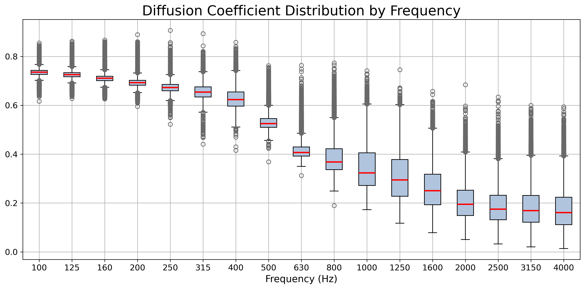
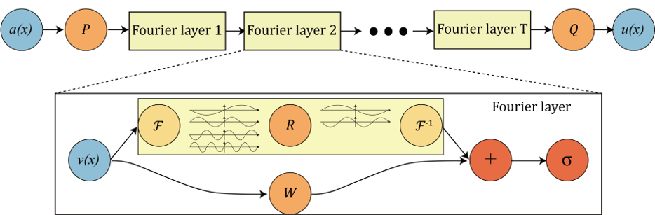
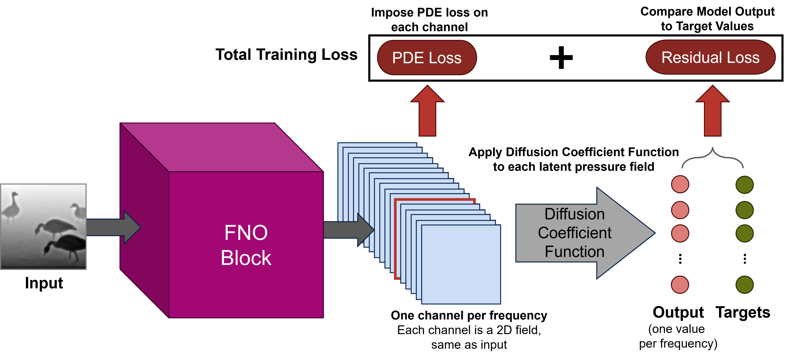

# Neural Operators for Acoustic Diffusers
_Testing Neural Operator architectures for acoustic diffusion modeling._


## Abstract

This project explores the prediction of acoustic diffusion coefficients produced by a given relief by leveraging Fourier Neural Operators. We implement different architectures, addressing the mismatch of input and output dimensions troubling the FNO,  and compare model performances. This repository doubles as both a sort of report of the project and a reproducible codebase.


## Contents
- [Problem Statement](#problem-statement)
- [Dataset](#dataset)
- [Implemented Architectures](#implemented-architectures)
- [Experiments & Results](#experiments--results)
- [Future Work](#future-work)
- [Installation](#installation)
- [Structure](#structure)
- [Usage](#usage)
- [References](#references)


## Problem Statement
In this project, we aim to predict the acoustic diffusion coefficients produced by a given relief.  In particular, we consider a relief represented by a heightmap. This relief can for example be an acoustic diffuser as found in a sound booth. We then consider a point source to produce a sound signal. The signal travels to the relief where it is scattered. To evaluate the diffusion properties of the relief, we want to determine its acoustic diffusion coefficients for individual frequencies. To measure these coefficients one can compute the external acoustic pressures at listeners evenly placed on a hemisphere centered on the diffuser and then apply the diffusion coefficient formula per frequency to obtain the respective diffusion coeffecients.

<!--  -->
<div align='center'>
    
</div>


The computation of the pressures can be done using traditional physics solvers such as in [1], but it's very time-consuming, especially since it needs to be run for each relief individually. We therefore attempt employing machine learning methods to predict the diffusion coefficients.


## Dataset 
As the base dataset, we used the Mini-ImageNet dataset, consisting of 100 classes of 600 images each. Of these, 32'825 were processed as follows:
- Using the Depth-Anything-V2 model, the depth of each point is estimated.
- Following Weyrich et al. [4], a Bas-Relief heightmap is generated from this depth information.
- The heightmap is cropped to a centered square and resized to size 256
- The heightmap is optimized w.r.t. a smoothness loss, to avoid abrupt height changes.
- The heightmap is padded with zeros at the borders.
These heightmaps were then stored as PNGs, see `generate_hmaps.py` to generate and save the heightmaps and `hmaps_png/` for the generated heightmaps.

To obtain the acoustic diffusion coefficients for a heightmap, a physical PDE solver is used, namely [1]. The entire pipeline from imapge to diffusion coefficients can be run with the script `run_pipeline.py`. The diffusion coefficients of the 32'825 processed images can be found in `mini_imagenet/coeffs.csv`.

The diffusion coefficients take values between $0$ and $1$, where coefficients for lower frequencies take bigger values of around $0.7$, while coefficients for higher frequencies take smaller values of around $0.2$. Their distribution can be seen in more detail in the figure below. This figure was generated using the notebook `DataExploration.ipynb`.

<div align='center'>
    
</div>


## Implemented Architectures

### CNN
As a baseline, we use a standard CNN architecture. We use two convolutional layers, both followed by a Max Pooling layer. The outputs are then flattened to be 1-dimensional and fed through two linear layers. The number of outputs corresponds to the number of frequencies for which we have have coefficients.

<div align='center'>
    
</div>

This architecture is implemented in `models/cnn.py` and can be trained using the script `run_cnn.py`


### FNO

#### Brief Introduction to FNOs
Where neural networks learn individual functions, predicting its output values given an input, neural _operators_ learn entire families of functions: they learn an operator between function spaces. Thus, given an input function, e.g. the initial conditions of a PDE, we can simply perform a forward pass through the trained neural operator and receive the corresponding solution function, rather than having to train an individual network for each set of input parameters. This makes neural operators especially relevant for solving PDEs, where traditional solvers are often very time consuming and have to be rerun for each individual set of initial conditions and parameters.

Fourier Neural Operators (FNOs) boost the efficiency of the original neural operators, by formulating the integral kernel directly in Fourier space and making use of properties of the Fourier transform. After an initial pointwise projection into a higher dimensional space, the input function is fed through an adjustable number of Fourier layers, and then (again pointwise) projected down to the desired number of channels. In each Fourier layer, the input is transformed into Fourier space, where convolution is now just multiplication. Thus, the input is multiplied with a kernel matrix $R$ and then transformed back to physical space. Finally, a linear transformation of the input is added and a non-linear activation is applied. For more details, see [2]. 
<div align='center'>
    
</div>


When solving PDEs, FNOs can be further augmented by imposing a physics-informed loss based on the PDE, which improves both generalization and physical validity. For more details, see [3].

In our setting, our heightmap input can be interpreted as functions
$ 𝐻\colon [0, 256]^2\to ℝ\times[0,256]^2  $  from the space of pixel coordinates to the space of pixel coordinates times the channel values, which for weight maps are 1-dimensional.   
Our output coefficients can be interpreted as functions $𝐶\colon ℝ\toℝ$, taking in a frequency and outputting the corresponding  coefficient value.
 
However, for an FNO, Input and Output functions must be defined on the same domain, though they can have different codomains. In other words: the spatial dimensions are preserved, but the number of channels can change. Notably, **this is not satisfied by our setting!**

We considered two architectures to address this issue:

#### FNO with Global Pooling
<div align='center'>
    
</div>

In this architecture, we first run our inputs through a standard FNO block. This block predicts a 2D field for each channel, where the number of channels is a configurable hyperparameter. We then use global max pooling to reduce these 2D fields to a single value per channel, thus obtaining a 1D output. Finally, we append a linear layer to get the desired number of output channels, in our case the number of frequencies. An implementation of this class can be seen in `models/fno.py` in the class `FNOtoScalar`.

Unfortunately this architecture doesn't make use of a physical loss. While the complex acoustic pressures $u$ satisfy the Helmholtz equation
$$ \nabla^2 u + k^2\cdot u = 0 \,,$$
the diffusion coefficients are not as easily goverend by a PDE, especially since the function used to obtain the coefficients from the pressures is not invertible.


#### FNO with Latent Pressures
The lack of physical information in the previous architecture inspired the idea of interpreting the 2D output (per channel) of the FNO as a pressure field. We can then impose a physics loss, namely the Helmholtz equation above, on this pressure field. This must be done individually for each channel resp. frequency, since the wavenumber $k$ depends on the frequency.

<div align='center'>
    
</div>

After computing the physics loss, we can then obtain the coefficients from the pressures using the known diffusion coefficient function. Given the coefficients, we can then compare them to the ground truth coefficients and take a residual loss.

To compute the physics loss, we again make use of the Fourier transform, since this significantly simplifies differentiation: For a function $u(x,y)$ with a Fourier transform $\widehat{u}(k, j) = \mathcal{F}(u) (k, j)$, its second derivates satisfy
$$ \mathcal{F}(\partial_{xx} u) = -k^2 \, \widehat{u}(k, j) $$
$$ \mathcal{F}(\partial_{yy} u) = -j^2 \, \widehat{u}(k, j) $$
For an implementation of this loss, see the class `PDEloss` in `utils.py`

In the physics solver that produced our dataset, the acoustic pressures are considered to be complex-valued. We therefore also implemented a version of this loss that considers complex pressures. Instead of predicting complex values, we instead encode the complex values in two separate separate real-valued channels, one for the real part, one for the imaginary part. The FNO block must therefore have twice as many output channels as frequencies.

## Experiments & Results

### Comparing Architectures

We trained and evaluated all model architectures described above on both heightmaps as well as images. We then computed the mean relative error
$$ MRE = \frac{1}{N}\sum_{i=1}^N \frac{|\hat{y}_i - y_i|}{|y_i|} \quad \text{for } \hat{y}_i \text{ the model prediction, }  y \text{ the target}$$
per frequency for each model. The models are trained and evaluated on the same fixed split of the data, so the results are indeed comparable. The results can be seen in the figure below.

<div align='center'>
    
</div>

This figure was generated using `plot_inference.ipynb`

As we can see, the model `FNOtoScalar`, i.e. the FNO with global pooling, performed best for both image and heightmap data. The physics-informed FNO with latent pressures on the other hand performed significantly worse. As this implementation was a rather loose interpretation of physics-informed models, this is not entirely unsurprising.

We further note that all models perform better on heightmaps than on images, though for the physics-informed FNO the difference is not as significant. Since for image data, the model first needs to extract depth information before it can model the accoustic diffusion coefficients this is expected behavior.

Furthermore, in all cases the models perform significantly better on lower frequencies than on high frequencies. This difference can likely be brought to the difference in scale between the coefficients: for the low frequencies, the diffusion coefficients take values of around $0.7$. But as the frequencies increase, the coefficient values decrease to around $0.2$ for the highest frequencies. It's possible that for such small values the models struggle to pinpoint the precise targets.

### Performance w.r.t. amount of data 
One possible reason why the physics-informed FNO with latent pressures performs so badly is that it has insufficient training data. To investigate this, we trained the physics-informed FNO on only a subset of the available data. The results can be seen in the table below.
| **#samples** | **MRE (in %)** |
|--------------|:--------------:|
| 10k          |      17.87     |
| 20k          |      17.84     |
| 32k (full)   |      16.94     |

As we can see, increasing the amount of training data only leads to a marginal improvement. To achieve an MRE comparable to that of the FNO with Global Pooling, we would likely need _significantly_ more training data. We conclude that generating more training data is not worth it for this particular architecture.

### CNN with physics loss
Since the FNO couldn't benefit from this physics loss concept, we wished to investigate whether the simpler CNN architecture could. The architecture is analogous to the physics-informed FNO with latent pressures: we essentially replace the FNO Block with Convolutional + Pooling layers as in the CNN, but instead of flattening layers and feeding them through linear layers, we take the PDE loss and compute the diffusion coefficients for the residual loss.

On heightmap data, when keeping the same convolution architecture as for our baseline CNN, we found that this significantly worsened performance:
| **Model**            | **MRE (in %)** |
|----------------------|:--------------:|
| Baseline CNN         |      10.24     |
| Physics-informed CNN |      22.42     |

While, there has not been much experimentation in this avnue, this nonetheless strongly suggests that this form of a physics-loss has no further potential.

### Deep CNNs
We further experimented a little with deeper CNN architectures. Instead of using only 2 sets of Convolutional + MaxPooling layers, we used 18 layers instead. This indeed resulted in an improvement of performance, though the FNO with Global Pooling still outperforms this architecture. If an additional ReLU layer is added after each MaxPooling layer, the performance drops significantly

| **Model**          | **MRE (in %)** |
|--------------------|:--------------:|
| Baseline CNN       |      10.24     |
| Deep CNN           |      9.73      |
| Deep CNN with ReLU |      16.56     |

These experiments suggest that with more adjustments of the CNN architecture performance can be further improved.

### Pretrained Vision Models
At the very end of this project, we also wanted to experiment with using pretrained Vision Models from `timm` instead of custom CNNs. Such models can be finetuned with `run_pretrained.py`. Unfortunately there was no time to properly test the performance of these models, but initial results are promising.

## Future Work

### 3D FNO
Instead of using the 1D coefficients as the target, one could also use a 3D pressure field (obtained through the physics solver) as the target. This would allow to take both physical and residual loss on the model output and anchor the predicted pressure values more firmly. With this strategy there is still a mismatch of input and output dimensions: the input image is 2D with 1 resp. 3 channels, while the output is 3D with one channel per frequency. To circumvent this, one could stack the the 2D images to obtain a 3D input and equip each of these layers with a height variable to encode depth. Alternatively, one could make use of more sophisticated methods such as FiLM layers [5].

Since computing the pressure values is expensive, they are only available on a lower resolution grid of $32\times 32\times 32$. The images however have a far higher resolution of $256\times 256$. The FNO however expects input and output to have the same shape (with variable number of channels). One possible way to address this is to downsample either the input image or the FNO output to match the resolution of the pressures, using e.g. convolutional and pooling layers.
Alternatively, one can still predict the high-resolution pressure field but to compute the residual loss subsample the predicted pressure field only on a subgrid matching the target pressure data.

Finally, the pressures computed by the physics solver are complex-valued. Since PyTorch doesn't support complex values, the pressures have to be encoded, e.g. by splitting them into separate real-valued channels for real and imaginary part.

### Spherical physical loss
Since listeners are assumed to be on a hemisphere, one could assume that the latent pressures also form a hemisphere. In this case, the Helmholtz equation most be formulated in spherical coordinates:
$$\frac{1}{𝑟^2}   \frac{𝜕}{𝜕r} \left(𝑟^2  \frac{𝜕𝑢}{𝜕𝑟}\right)+  \frac{1}{𝑟^2  \sin⁡𝜃 }  \frac{𝜕}{𝜕𝜃}  \left(\sin⁡𝜃  \frac{𝜕𝑢}{𝜕𝜃} \right)+\frac{1}{𝑟^2  \sin^2⁡𝜃 }  \frac{𝜕^2 𝑢}{𝜕𝜙^2 }+𝑘^2 𝑢=0 $$
This equation is clearly more complicated than the original Helmholtz equation. To implement this PDE loss, one would likely have to make use of spherical harmonics, which would require some further research. 


## Installation

- Clone the repository: `git clone https://github.com/eboesch/AcousticDiffusers.git`
- Create a conda virtual environment with `conda create -n venv` and activate it with `conda activate venv`.
- Install pip in the virtual environment: `conda install pip`
- Install dependencies in virtual environment: `python -m pip install -r requirements.txt`


## Structure
```
AcousticDiffusers/
├── dataset/                     # Directory for all files to do with dataset
│   ├── DataExploration.ipynb    # Notebook for exploring Image dataset
│   ├── dataset.py               # File with implementations of custom dataset classes
│   ├── generate_hmaps.py        # Script for generating and saving heightmaps
│   ├── HeightMapAnalysis.ipynb  # Notebook for comparing heightmap storage formats
│   ├── n01532829_124.npy        # Sample pressure values
│   ├── test_paths.txt           # File with path of images assigned to test set 
│   ├── train_paths.txt          # File with path of images assigned to training set
│   └── val_paths.txt            # File with path of images assigned to validation set
├── figures/                     # Directory for figures for README
├── hmaps/                       # Directory for Heightmap Dataset stored as npy files   (untracked)
├── hmaps_png/                   # Directory for Heightmap Dataset stored as PNGs        (untracked)
├── literature/                  # Directory for literature and references               (untracked)
├── logs/                        # Directory for training logs                           (untracked)
├── mini_imagenet/               # Directory for Image Dataset                           (untracked)
│   └── coeffs.csv               # File containing target diffusion coefficients         (untracked)
├── models/                      # Directory for model implementations
│   ├── cnn.py                   # File with CNN implementation and training functions
│   └── fno.py                   # File with FNO implementation and training functions
├── pipeline/                    # Directory for Physics Solver implementation
├── working/                     # Directory for helper functions for heightmaps/coeffs
├── control.ipynb                # Notebook for checking heightmap generation
├── plot_inference.ipynb         # Notebook for plotting inference results  
├── requirements.txt             # Dependencies  
├── README.md                    # This file  
├── run_cnn_inference.py         # Script for running inference of CNN-based model  
├── run_cnn.py                   # Script for training CNN-based model  
├── run_fno_inference.py         # Script for running inference of FNO-based model  
├── run_fno.py                   # Script for training FNO-based model  
├── run_pipeline.py              # Script for generating diffusion coefficients
├── run_pretrained.py            # Script for finetuning pretrained vision models
└── utils.py                     # File containing several utility functions
```


## Usage


### Running the Diffusion Coefficient Pipeline
To run the pipeline for generating the diffusion coefficients, use: 
```bash
python run_pipeline.py --dir mini_imagenet/n13054560 --csv_file mini_imagenet/coeffs.csv
``` 
This loads all pictures from `mini_imagenet/n13054560` and writes the diffusion coefficients per frequency to `mini_imagenet/coeffs.csv`.

### Generating Heightmaps
To generate and save the heightmaps as PNGs, run:
```bash
python dataset/generate_hmaps.py
```
In the file itself, the directory where the files should be saved can be specified with the variable `output_dir`. To select which images should be processed, the variable `image_paths` can be adjusted. The code currently has implementations for processing either all images, or only the ones for which coefficients have been computed. Finally, the storage format can be changed by adjusting the variable `output_path` and selecting the matching `save` command.

In the notebook `HeightMapAnalysis.ipynb` different storage formats were compared, with the conclusion that saving the heightmaps as a PNG leads to the best reconstruction error.

### Data Handling
The paths to image and heightmap data as well as the target coefficients can be configured through the variables `data_dir`, `hmap_dir` resp. `targets_path` in all training and inference scripts.


In `dataset/dataset.py` custom dataset classes are implemented. The classes `ImageDataset` and `DictImageDataset` are intended for the original RGB images. The classes `HmapDataset` and `DictHmapDataset` are intended for heightmaps: at initialization the file type of the heightmaps can be provided and the paths are internally corrected accordingly. The two `Dict` classes are intended for FNO training, since the FNO trainers expect items to be provided as dictionaries.

The dataset classes support custom preprocessing of both input data and targets. The `transform` function for preprocessing the input data, and the `target_transform` function for preprocessing the targets can be provided at initialization or later using `dataset.set_transform` resp. `dataset.set_target_transform`. 

One can further calculate the mean and standard deviation of input data and targets using `dataset.calculate_data_stats()` resp. `dataset.calculate_target_stats()`. We make use of this to create custom normalization functions 
$$ x' = \frac{x-\mu}{\sigma} $$
for $\mu$ the mean and $\sigma$ the standard deviation of the dataset. We use these normalization functions to preprocess both the input data as well as the targets.

When using images as input data, we further ensure that the input matches that to the heightmap and diffusion coefficient pipeline. Namely, the images are cropped to a maximal central square and resized to $(256, 256)$, see `pipeline_transform` in `dataset/dataset.py`.

### Training a CNN
The CNN architectures as well as the corresponding training and testing functions are implemented in `models/cnn.py`. To train a CNN, run
```bash
python run_cnn.py
```
A variety of hyperparameters such as number of epochs, batch size, learning rate, training loss or number of Convolutional+Pooling layers can be specified by changing the corresponding variables in `run_cnn.py`. For each model, a log with training progress and model specifics is created and saved. If `save_model = True`, the model is saved in the same directory.

To select whether the model should be trained on heighmaps or images, set the variable `dataset_type` to the corresponding value. The variable `dataset_split` determines how the dataset is split into training, validation and test sets:
- `pre_split`: Use predefined data split. The paths are read from `.txt` files in `dataset/` for each split.
- `random_split`: The data splits are randomly generated as random subsets of the set of all paths.
- `subset`: Instead of the whole dataset, only a subset is used. The number of total samples used can be configured, and the splits are generated randomly.

For the generation of `.txt` files with fixed data splits, see the notebook `DataExploration.ipynb`. That notebook also contains a variety of exploratory investigations, e.g. about the size of the images, the distribution of train/val/test per image class, etc.

To train a CNN with physics-informed loss, set `model = PhysicsCNN(*args)`. The architecture is implemented in the class `PhysicsCNN` in `models/cnn.py`

### Training an FNO
For training FNO-based models we use the `neuraloperator` package. It provides implementations of FNOs and the corresponding training and evaluation framework. We slightly adapted their Trainer class by incorporating logging of training progress and intermediary evaluations, see the class `CustomTrainer` in `models/fno.py`.

For each batch, the FNO Trainer framework computes losses by averaging first over spatial dimensions and then summing over batch and channel dimension. After iterating over all batches it then takes the mean. We implemented wrappers for MSE, MAE and MRE to match this behavior, see the classes `FNO_MSE`, `FNO_MAE` and `FNO_MRE` in `models/fno.py`

To train an FNO-based based model, run
```bash
python run_fno.py
```
The architecture-dependent adjustments will be discussed below.

A variety of hyperparameters such as number of epochs, batch size, training loss, number of Fourier layers etc. can be specified by changing the corresponding variables in `run_fno.py`. For each model, a log with training progress and model specifics is created and saved. If `save_model = True`, the model is saved in the same directory.

As for CNNs, the data type on which the model should be trained on must be specified with `dataset_type` and the generation of the data splits must be specified using `dataset_split`.

#### FNO with Global Pooling
This architecture is implemented in the class `FNOtoScalar` in `models/fno.py`. To train such a model, ensure that 
```
model = FNOtoScalar(*args)
```

#### Physics-Informed FNO with Latent Pressures
For training this architecture, we further adjust the `CustomTrainer` class to compute the physics loss and the diffusion coefficients before taking the residual loss, see the class `PhysicsTrainer` in `models/fno.py`.

To train such a model, set
```bash
model = FNO(*args)
```

The PDE loss is implemented in the class `PDEloss` in `utils.py`. The implementation supports sum, mean and no reduction, but in practice we have found mean reduction to be far superior. Currently two types of spectral losses (i.e. computing derivatives in Fourier space) are implemented:
- For `deriv_type = spectral`, the latent pressures are considered real-valued. Thus, set `model = FNO(out_channels=output_size, *args)`.
- For `deriv_type = spectral_complex`, the latent pressures are considered complex-valued. Thus, set `model = FNO(out_channels=2*output_size, *args)`.

### Finetuning a Pretrained Transformer Model

To finetune a pretrained transformer model from `timm` to our problem, run
```bash
python run_pretrained.py
```
The model can be chosen by setting the variable `model_name`. As for training the other models, the data type on which the model should be trained must be specified with `dataset_type` and the generation of the data splits must be specified using `dataset_split`.

Note that, currently, heightmaps are read as RGBs with 3 channels instead of gray scale images with 1 channel. This is because the transformer models' default preprocessing transform expects 3 input channels, so to read heightmaps as grayscale would require changing the preprocessing transform as well.


### Inference
To run inference on a model (i.e. evaluate it), use
```bash
python run_cnn_inference.py
```
if the model being evaluated is a CNN, resp.
```bash
python run_fno_inference.py
```
if the model being evaluated uses FNOs.

Both scripts load a trained model and evaluate it on test data. For a model `logs/2025-09-04-11-06-45/best_model.pth`, the timestamp `2025-09-04-11-06-45` identifying the model is called the `model_code`, and `best_model` is the `model_type`. To evaluate a different model, change `model_code` and `model_type` accordingly, or modify `model_path` directly. With the variable `data_split` the data split on which the model is to be evaluated can be specified. Currently only `val` and `test` are supported. For `save_inferences = True`, all model predictions and the corresponding targets, as well as elementwise MAE, MSE and MRE, are saved to a CSV file.

Finally, as during training of the models, the data type on which the model was trained must be specified with `dataset_type` and the generation of the data splits must be specified using `dataset_split`. If you wish to be sure that the same data splits as during training are used, we recommend using `pre_split` with fixed splits stored in `.txt``files.

For FNO-based models, the `model_class` must further be specified. For the FNO with global pooling, set 
```bash
model_class = FNOtoScalar
```
and for the physics-informed FNO with latent pressures, set
```bash
model_class = FNO
```

With the notebook `plot_inferences.ipynb` the inference results can be visualized, particularly the performance by frequency. For visualizing inference results of a sinlge model, the inference file can be provided directly via its path. For the main models trained, the results can be directly retrieved as a dataframe with the function `fetch_inferences`. The final code block plots the results of all 3 models on both data types. The loss can be selected with `loss_type`.


### Running Scripts over night
- `nohup python run_fno.py > output.log 2>&1 &`
- To check on processes: `ps -u $USER | grep python`
- If you want to kill a process: `kill <PID>` where PID is the process ID you read out from the previous command.


## References

[1]   AnonymousAuthor(s). 2025. Acoustic Reliefs. ACMTrans. Graph. 1, 1 (June 2025), 21 pages.                        https://doi.org/10.1145/nnnnnnn.nnnnnnn  
[2]   Li, Z., Kovachki, N.B., Azizzadenesheli, K., Liu, B., Bhattacharya, K., Stuart, A.M., & Anandkumar, A. (2020). Fourier Neural Operator for Parametric Partial Differential Equations. ArXiv, abs/2010.08895.  
[3]   Li, Z., Zheng, H., Kovachki, N.B., Jin, D., Chen, H., Liu, B., Azizzadenesheli, K., & Anandkumar, A. (2021). Physics-Informed Neural Operator for Learning Partial Differential Equations. ArXiv, abs/2111.03794.  
[4]   Tim Weyrich, Jia Deng, Connelly Barnes, Szymon Rusinkiewicz, and Adam Finkelstein. 2007. Digital bas-relief from 3D scenes. ACM Trans. Graph. 26, 3 (July 2007), 32–es. https://doi.org/10.1145/1276377.1276417  
[5]   Perez, E., Strub, F., Vries, H.D., Dumoulin, V., & Courville, A.C. (2017). FiLM: Visual Reasoning with a General Conditioning Layer. AAAI Conference on Artificial Intelligence.

